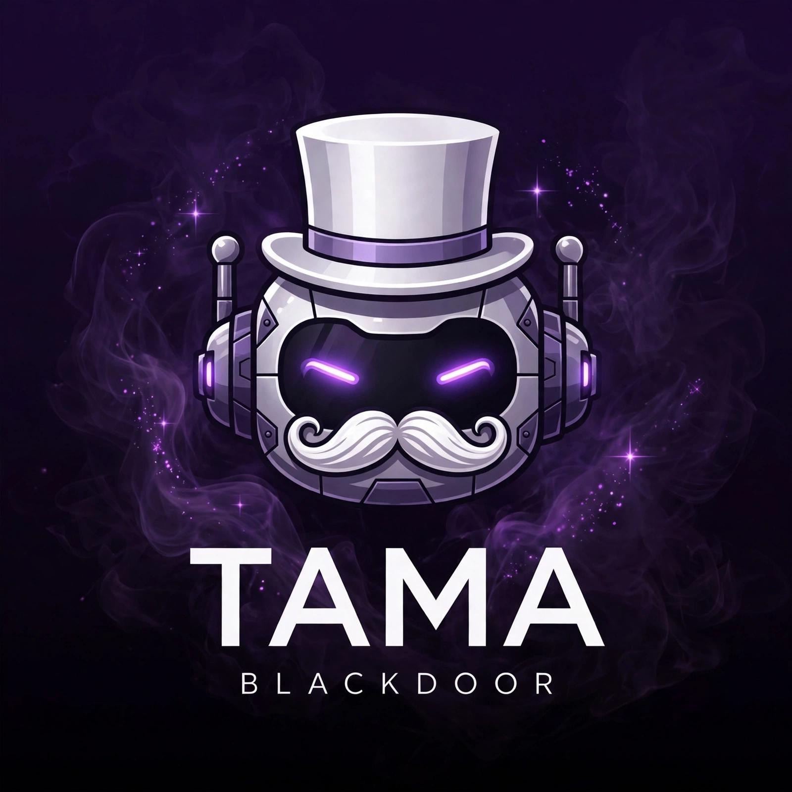

 

<h1 align="center">🚪 BLACKDOOR</h1>

 <b>Bot WhatsApp Paling Gacor!</b> 
 By <b>Tama-ID</b>

 
 
 
 

---

✨ Fitur Utama

*🤖 AI*
- `.ai` / `.gpt` / `.aitama` - Tanya apa aja ke AI!

*📥 Downloader*
- `.tiktok <link>` - Download TikTok tanpa watermark + musiknya!
- `.ig <link>` - Download Instagram Reels / Foto / Video!
- `.ytmp3 <judul>` - Download lagu YouTube jadi MP3!

*🎨 Sticker*
- `.sticker` - Bikin sticker dari foto / video!
- `.brat <teks>` / `.bratvid <teks>` / `.bratvid2 <teks>` / `.bratvid3 <teks>` - Sticker brat viral!
- `.toimg` - Sticker jadi foto lagi!
- `.tourl` - Foto / video jadi link!

*👥 Group*
- `.kick @orang` / `.add <nomor>` / `.promote @orang` / `.demote @orang`
- `.tagall <pesan>` / `.hidetag <pesan>` / `.listadmin`
- `.link` / `.revoke` / `.setname <nama>` / `.setdesc <deskripsi>`
- `.mute` / `.unmute`
- `.antivirtex on/off` - Auto kick yang kirim virtex!
- `.antilink on/off` - Auto kick yang kirim link grup lain!
- `.antijudol on/off` - Auto kick yang promosi judi!
- `.antidelete on/off` - Kalo ada yang hapus pesan, bot kirim lagi!
- `.antiluar on/off` - Auto kick nomor luar!
- `.antisticker on/off` - Auto kick yang spam sticker!
- `.welcome on/off` - Sambut yang baru masuk!
- `.goodbye on/off` - Ucapin bye yang keluar!
- `.pinpesan` - Pin pesan!

*🎮 Game / Fun*
- `.slot` - Main slot!
- `.cekkhodam <nama>` - Cek khodam lu!
- `.jodoh <nama1> & <nama2>` - Cek jodoh!
- `.ceksisaumur <nama>` - Cek sisa umur (fun aja!)
- `.cekpsikopat <nama>` - Cek psikopat!
- `.cekgabut <nama>` - Cek gabut!

*👑 Owner*
- `.owner` - Liat kontak owner!
- `.restart` - Restart bot!
- `.backup` - Backup config!
- `.self` - Bot cuma respon owner!
- `.public` - Bot respon semua!
- `.infobot` - Info bot + foto bot!
- `.broadcast <pesan>` / `.bc <pesan>` - Kirim ke semua grup!
- `.ban @orang` / `.unban @orang` - Ban / unban orang!
- `.setppbot` - Ganti foto bot!
- `.clearsession` - Bersihin sampah session!

*💰 Donate*
- `.donate` - Liat QRIS buat support!

---

🚀 Cara Install

git clone https://github.com/tamayana/blackdoor.git
cd blackdoor
npm install
npm start

> Buka `config.js`, ganti nomor owner, terus jalanin `npm start` dan ikutin petunjuk di terminal buat login pake Pairing Code.

⚙️ Setting di http://config.js

export default {
 owner: ['62xxxx'],
 ownerName: 'Tama-ID',
 botName: 'Blackdoor',
 prefix: '.',
 selfMode: false,
 antivirtex: false,
 antilink: false,
 antijudol: false,
 antidelete: false,
 welcome: false,
 goodbye: false,
 antiluar: false,
 antisticker: false,
 banned: []
};

📁 Struktur Folder

blackdoor/
├── index.js
├── config.js
├── package.json
├── README.md
├── plugins/
│ ├── menu.js
│ ├── donate.js
│ ├── owner.js
│ ├── group.js
│ ├── downloader.js
│ ├── sticker.js
│ ├── ai.js
│ └── game.js
└── media/
 ├── bot.jpg
 ├── blackdoor.jpg
 └── qris.jpg

---

💰 Donate

Suka sama bot ini? Support biar makin gacor!

Ketik `.donate` di bot buat liat QRIS!

---

 <b>© Blackdoor by Tama-ID</b> 
 Jangan lupa kasih ⭐ di repo ini ya bung!

~~~

